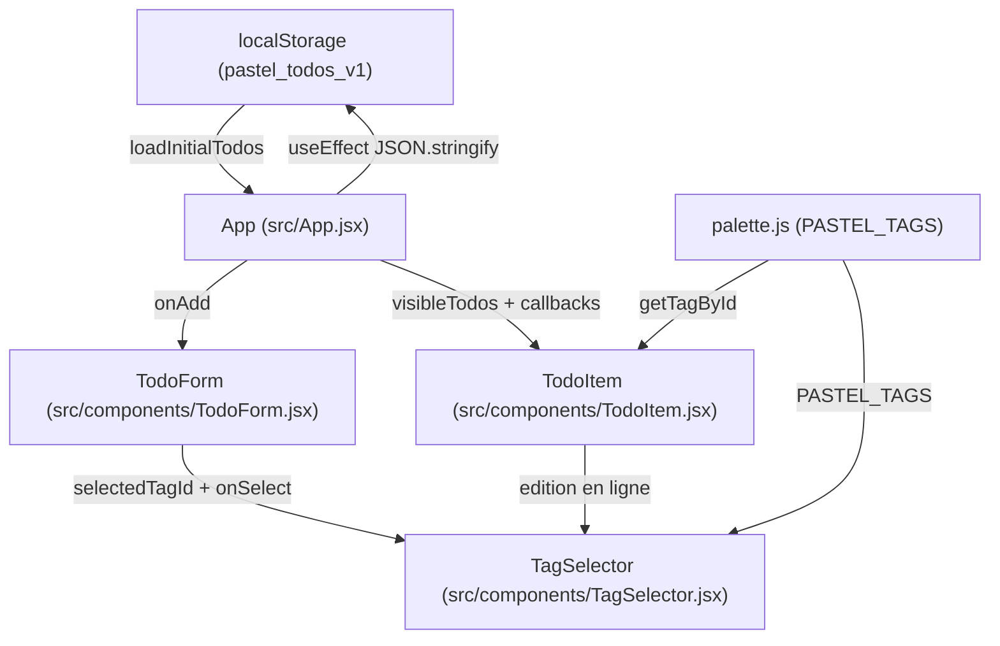

L'application repose sur **React 18** et **Vite 5** sans bibliothèque de gestion d'état externe. L'ensemble de l'état applicatif est centralisé dans le composant racine `App` et propagé vers les composants enfants par props.

## Vue d'ensemble du flux de données

## Point d'entrée et configuration

Le montage React s'effectue dans `src/main.jsx` avec `<StrictMode>` sur l'élément DOM `#root` défini dans `index.html`, en chargeant la feuille de styles globale `src/styles/index.css`.

La configuration Vite (`vite.config.js`) active uniquement `@vitejs/plugin-react` sans options personnalisées.

## Cycle de vie de l'état

<Steps>
  <Step title="Chargement initial paresseux">
    `useState(loadInitialTodos)` exécute `loadInitialTodos()` une seule fois au montage. La fonction lit la clé `pastel_todos_v1` dans `localStorage`. Si la clé vaut `null`, si le parsing JSON échoue ou si la valeur parsée n'est pas un tableau (`!Array.isArray(parsed)`), l'application bascule sur `INITIAL_TODOS` (3 tâches d'exemple).
  </Step>
  <Step title="Calculs dérivés mémoïsés">
    Deux `useMemo` dérivent les données d'affichage à partir de `todos` et `filter` :
    - `counts` calcule `{ all, active, completed }`.
    - `visibleTodos` filtre `todos` selon `filter` (`'all'`, `'active'` ou `'completed'`).
  </Step>
  <Step title="Synchronisation automatique">
    Un `useEffect` dépendant de `[todos]` sérialise la liste avec `JSON.stringify(todos)` dans `localStorage`. Les erreurs de quota ou de navigation privée sont interceptées dans un bloc `try/catch` silencieux.
  </Step>
</Steps>

## Règles métier des mutations

<AccordionGroup>
  <Accordion title="Création et identifiants uniques">
    `handleAdd(title, tagId)` génère un identifiant via `createTaskId()` (`crypto.randomUUID()` si disponible, sinon un repli `${Date.now()}-${Math.random().toString(16).slice(2)}`), initialise `completed` à `false` et insère la nouvelle tâche en tête de liste (`[newTodo, ...prev]`).
  </Accordion>
  <Accordion title="Duplication d'une tâche">
    `handleDuplicate(id)` recherche la tâche source par index dans `todos`. Elle crée une copie avec un nouvel identifiant, le même `tagId` et `completed: false`, puis l'insère immédiatement après l'originale (`index + 1`). Le suffixe `' (copie)'` est ajouté au titre uniquement si `source.title.length + 8 <= 140`.
  </Accordion>
  <Accordion title="Mise à jour, bascule et suppression">
    - `handleToggle(id)` inverse le booléen `completed` de la tâche ciblée.
    - `handleUpdate(id, updates)` fusionne l'objet `updates` (`{ title, tagId }`) dans la tâche correspondante.
    - `handleDelete(id)` retire la tâche par filtrage sur `id`.
    - `handleClearCompleted()` supprime en masse toutes les tâches dont `completed === true`.
  </Accordion>
</AccordionGroup>

<Info>
  Le filtrage appliqué à l'affichage (`visibleTodos`) n'affecte jamais l'index d'insertion dans `todos` lors d'une duplication : la copie est toujours placée juste après la tâche source dans le tableau complet.
</Info>

